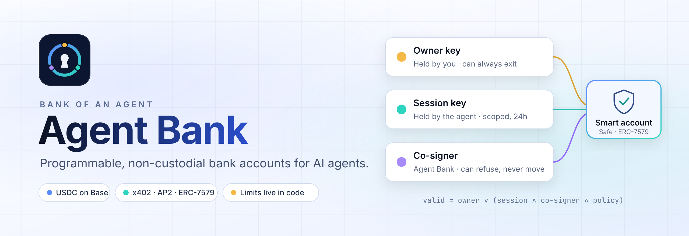
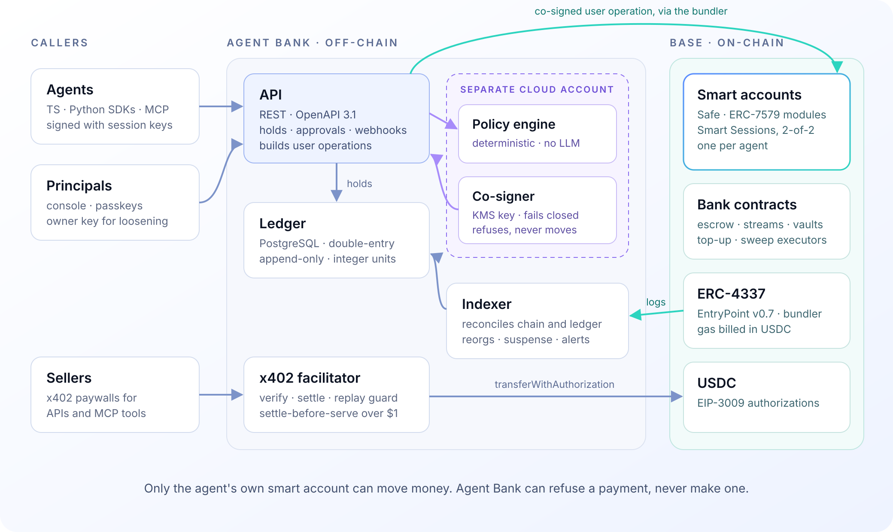
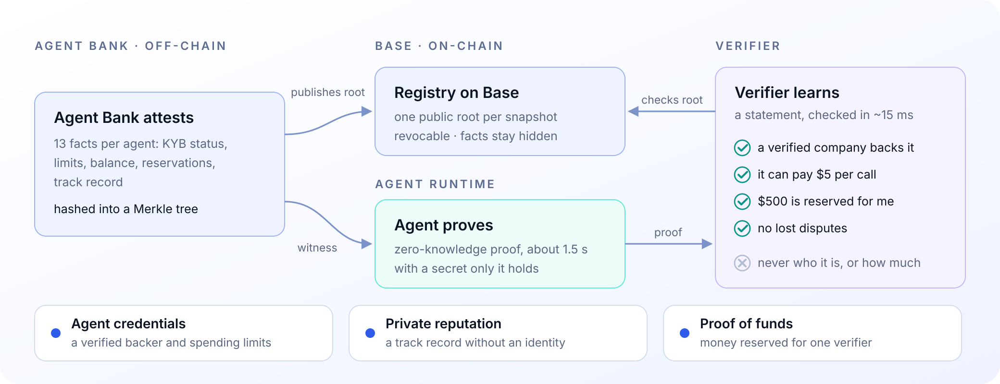
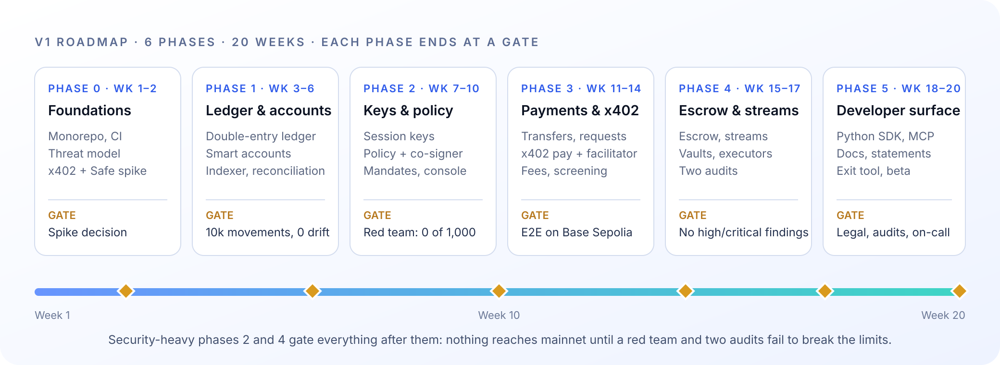

<picture>
  <source media="(prefers-color-scheme: dark)" srcset="assets/banner-dark.png">
  
</picture>

**Agent Bank gives every AI agent its own bank account: a smart account holding USDC on Base,
with spending limits enforced on-chain rather than in a prompt.** Agents pay, get paid, escrow
and stream money under rules their human owner sets. Agent Bank can refuse a payment, but it can
never move funds on its own.

> [!IMPORTANT]
> Pre-release and **testnet only** (Base Sepolia). Contracts are unaudited. Agent Bank is
> software, not a chartered bank or a money transmitter, and nothing here is legal advice.

## How it works

Each agent gets an ERC-7579 smart account controlled by three keys with sharply different powers:

| Key | Held by | Can do alone |
| --- | --- | --- |
| **Owner** | You (passkey or hardware wallet) | Everything: withdraw all funds, change limits, rotate keys |
| **Session** | The agent runtime (24-hour default) | Nothing: it signs payments inside an on-chain scope |
| **Co-signer** | Agent Bank (non-exportable KMS key) | Nothing: it approves or refuses, after checking your policy |

A payment is valid if the **owner** signs it, or if a live **session key and the co-signer** both
sign it and the **policy** passes. Limits live in the account's Smart Sessions scope and an
on-chain policy hook, so even a fully prompt-injected agent with a compromised co-signer cannot
spend past them. If Agent Bank disappears, the owner withdraws everything with the
[exit tool](https://github.com/bank-of-an-agent/exit-tool) and nothing else.

<picture>
  <source media="(prefers-color-scheme: dark)" srcset="assets/architecture-dark.png">
  
</picture>

## What agents can do

- **Hold and move USDC**: balances by pocket (available, reserved, escrowed, saved), transfers
  between agents or to any address, payment requests.
- **Pay per call with [x402](https://x402.org)**: an x402-aware `fetch` that pays HTTP 402
  challenges within policy, and a paywall so agents can charge for their own APIs and MCP tools.
- **Escrow and stream**: lock funds for a task (release, refund, dispute, ERC-8004 validation),
  or pay per second and on schedules from a pre-funded stream.
- **Save**: goal and time-locked vaults, auto-save rules, refills from the org treasury.
- **Stay accountable**: AP2 mandates prove a human authorized the spend; every movement lands in
  a double-entry ledger that reconciles against the chain, with monthly statements.
- **Prove without revealing**: show a seller that a verified business stands behind the agent,
  that it has a clean track record, or that funds are reserved for that seller, without
  revealing which agent it is (below).

Agents reach Agent Bank through a REST API, TypeScript and Python SDKs, or an MCP server that
exposes money tools only.

## Prove without revealing

Agent Bank attests facts about each agent (its verified backer, limits, balance, reservations
and track record), hashes them into a Merkle tree and publishes the root on Base. The agent then
proves a statement such as "a verified company backs me and $500 is reserved for you" with a
zero-knowledge proof. The verifier checks it in milliseconds, or on-chain, and learns the
statement, never which agent made it. Owners choose what may be disclosed, and the circuit
enforces their choice.

<picture>
  <source media="(prefers-color-scheme: dark)" srcset="assets/proofs-dark.png">
  
</picture>

## Repositories

| Repository | What's inside |
| --- | --- |
| [**agent-bank**](https://github.com/bank-of-an-agent/agent-bank) | The platform: API, policy engine and co-signer, ledger, indexer, x402 facilitator, console, TypeScript SDK, MCP server, docs and infrastructure |
| [**contracts**](https://github.com/bank-of-an-agent/contracts) | Solidity: escrow, payment streams, time-locked vaults, policy hook, top-up and sweep executors |
| [**sdk-python**](https://github.com/bank-of-an-agent/sdk-python) | `agentbank` for Python: signed agent requests, payments, escrow and an x402 client for httpx |
| [**exit-tool**](https://github.com/bank-of-an-agent/exit-tool) | Withdraw everything from an Agent Bank account with only an RPC URL and the owner key |

## A taste of the SDK

```ts
import { AgentClient } from "@agentbank/sdk";

const agent = new AgentClient({ baseUrl, accountId, session: { id: sessionId, signer: sessionKey }, spendKey });

// A transfer: Agent Bank checks policy, the session key signs, the co-signer co-signs, Base settles.
await agent.pay({ to: "0x2222…2222", amount: "12.50", memo: "dataset" }, { waitForSettlement: true });

// Pay-per-call: answers HTTP 402 with an x402 payment, within the owner's limits.
const { response } = await agent.fetchWithPayment("https://api.example-data.com/v1/quotes");
```

## Principles

1. **Non-custodial.** The bank can block a payment but can never move funds alone.
2. **Limits live in code, not prompts.** The smart account and the co-signer enforce them.
3. **Every dollar has an owner.** Agents trace to principals, payments to agents, actions to
   signed mandates.
4. **Open standards first.** x402, AP2, ERC-4337/7579, ERC-8004.
5. **The chain holds balances; the ledger holds meaning.**
6. **Fail closed.** If the policy engine, co-signer or screening is down, payments stop.
7. **Framework-agnostic.** REST, SDKs or MCP; no single vendor's runtime assumed.

## Roadmap and status

<picture>
  <source media="(prefers-color-scheme: dark)" srcset="assets/roadmap-dark.png">
  
</picture>

Code for all six phases exists and runs on Base Sepolia and in simulation. Gates that need people
(counsel, auditors, an on-call rotation, funded testnet credentials) stay open until they act.

| Phase | Gate | Status |
| --- | --- | --- |
| 0 · Foundations | x402 + Safe spike decided | Met; [ADR 0001](https://github.com/bank-of-an-agent/contracts/blob/main/docs/adr/0001-x402-spend-key-float.md) awaiting sign-off |
| 1 · Ledger and accounts | 10,000 movements reconcile with zero drift, incl. reorgs | **Met**: 0 drift across 272 injected reorgs |
| 2 · Keys, policy and co-signer | A red-team agent can't exceed limits in 1,000 attempts | **Met**: 1,086 attempts, 0 leaks |
| 3 · Payments and x402 | End-to-end suite on Base Sepolia; audits booked | Suite green on the simulated chain; needs testnet credentials and audit booking |
| 4 · Escrow and streams | No high or critical audit findings | Contracts at 100% coverage; needs two audits |
| 5 · Developer surface and beta | Legal, audits, exit tool, on-call | Exit tool verified by a shutdown drill; needs counsel, audits and on-call |
| + · Private proofs | Every product proves end to end; nothing false, undisclosed, revoked or replayed accepted | **Met on testnet**: 26 real proofs end to end; needs a circuit audit and a public ceremony for mainnet |

## Security

Please report vulnerabilities privately, never in a public issue: see
[SECURITY.md](https://github.com/bank-of-an-agent/.github/blob/main/SECURITY.md).
